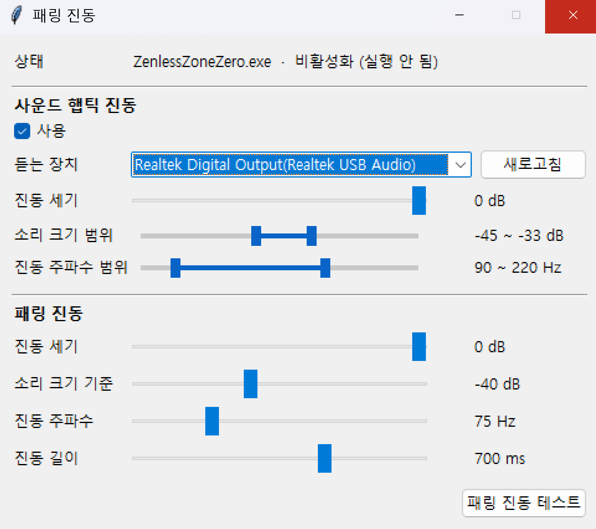

# 패링 진동 (ParryHaptic)

젠레스 존 제로를 DualSense로 할 때, 소리는 이어폰으로 들으면서 패드는 따로 진동시키는 트레이 프로그램.

## 의도

PC에서 젠레스를 듀얼센스로 하게되면 사운드 채우기로 유사 햅틱으로 플레이하는 수밖에 없음. 심지어 패링 진동도 없고, 사운드 기본출력을 패드로해야해서 영 마음에 들지 않음.
그래서 자체 햅틱 + 패링진동을 추가한 프로그램.

## 구현

게임은 소리와 햅틱을 한 스트림으로 보내서, Windows 기본 출력을 이어폰으로 두면 패드 햅틱이 사라짐.
그래서 설정한 출력장치의 소리를 수집해, 햅틱을 따로 만들어 패드 오디오 채널(ch3·4)로 보냄.

| 진동 | 동작 |
|---|---|
| 패링 진동 | 젠레스에서는 패드사용시 패드가 기본출력이 아니라고해도, 무조건 패링소리를 패드로 뿌려주고있음. 그래서 게임 소리와 섞이지 않아 난전 중에도 정확하게 처리가능 |
| 사운드 햅틱 진동 | 듣는 장치에서 소리 설정한 크기 범위를 넘는 소리가 나면 진동. 클수록 세고 낮은 주파수 |

- 게임(`ZenlessZoneZero.exe`)이 실행 중이고 패드가 연결됐을 때만 동작하고, **게임 창이 앞에 있을 때만** 동작하도록 만듬.
- 게임 파일, 메모리, 입력은 건드리지 않는다. 사용하는 건 Windows 오디오 캡처(WASAPI 루프백)와 패드 연결 확인만 처리.
- 설정파일은 APPDATA에 생성시 쓰레기 데이터 생길까봐, 유저 스코프로 생성안함. 지울땐 폴더째로 지우면 깔끔.

## 실행

1. 폴더하나 파서 받은 파일(ParryHaptic.exe)을 옮기고 실행. 설정파일은 실행파일과 같은 폴더에 생김. 키면 시스템 트레이에 동그란 아이콘 하나생김.
2. DualSense를 연결. usb도 되긴하지만 개인적으론 pico 2w 동글을 추천.
3. Windows 기본 출력을 **이어폰/스피커**로 설정. 패드로 두면 게임 소리가 섞여 부정확.
4. 패드 스피커 소리가 나는 게 싫으면, 피코 동글 설정에서 "Disable speaker / headset"을 켠다. usb로는 이거 처리가 좀 불편.
* 윈도우 듀센 소리설정을 게임내 패드 소리설정이 무시해버리는걸로 보임. 그렇다고 꺼버리면 패링 진동이 안옴. 정 동글 싫으면 패링 진동에서 소리크기 기준을 잘맞혀보셈.

- 트레이 아이콘을 우클릭하면 **열기 / 닫기**. 닫기를 누르면 완전히 종료. 창의 X 버튼은 창만 숨김.

## 설정

바꾸면 바로 적용되고 저장된다.

**사운드 햅틱 진동**

| 항목 | 설명 |
|---|---|
| 사용 | 켜고 끈다 |
| 듣는 장치 | 소리 크기를 재는 장치. 보통 이어폰. 처음엔 Windows 기본 출력이 고른다 |
| 진동 세기 | 가장 센 진동의 세기 |
| 소리 크기 범위 | 아래 끝보다 큰 소리부터 진동하고, 위 끝에서 최대 세기로 멈춘다. 배경음악에도 떨리면 올린다 |
| 진동 주파수 범위 | 약할 때는 높은 쪽(가볍게), 셀수록 낮은 쪽(묵직하게) |

**패링 진동**

| 항목 | 설명 |
|---|---|
| 진동 세기 | 패링 진동 세기 |
| 소리 크기 기준 | 패드로 이 크기를 넘는 소리가 들어오면 패링으로 본다 |
| 진동 주파수 | 낮을수록 묵직 |
| 진동 길이 | 맞는 순간 최대에서 시작해 서서히 줄어든다. 길수록 완만 |
| 패링 진동 테스트 | 게임 창 상태와 상관없이 한 번 진동 |

## 라이선스
Copyright 2026 icdsub. MIT License로 배포.

## 서드파티 라이선스
exe에는 아래 패키지가 수정 없이 그대로 들어 있고, 각자의 라이선스를 따른다.

- numpy, scipy, psutil: BSD-3-Clause
- hidapi: BSD-3-Clause 선택 (BSD / GPLv3 이중 라이선스)
- Pillow: MIT-CMU (HPND)
- PyAudioWPatch: Apache-2.0
- pystray: LGPL-3.0
- PyInstaller: GPL-2.0 + 예외 조항 (만든 exe에는 제약 없음)

pystray는 LGPL-3.0이라 소스 전체와 빌드 방법(`.github/workflows/release.yml`)을 공개해 누구나 다시 빌드할 수 있게 했다.
